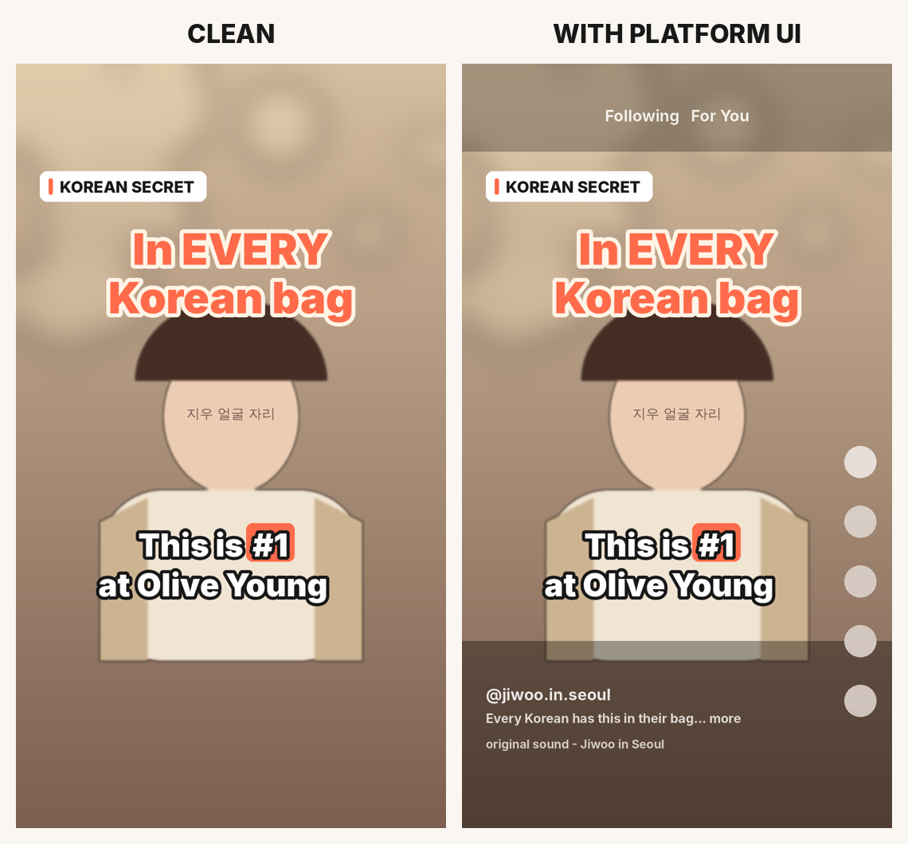

# 스타일 가이드 (확정 2026-10-29)

> 4단계 편집 템플릿 렌더러는 이 문서의 수치를 그대로 코드로 옮긴다. 기준 해상도 1080×1920.

## 색
| 이름 | 값 | 용도 |
|---|---|---|
| 코랄 | `#FF6B4A` | 훅 글씨, 강조 단어 배경, 라벨 세로선 |
| 크림 | `#FFF4E6` | 훅 글씨 테두리 |
| 잉크 | `#181818` | 라벨 글씨, 본문 자막 테두리 |
| 흰색 | `#FFFFFF` | 라벨 배경, 본문 자막 |

## 폰트
- 영어: **Inter Black** (훅, 본문 자막), **Inter ExtraBold** (라벨)
- 한국어(오늘의 한국어 한마디 등): 굵은 한글 고딕 (Pretendard Black 권장, 없으면 시스템 기본 굵은 고딕)

## 안전 영역 (플랫폼 UI 회피)
| 영역 | 범위 | 규칙 |
|---|---|---|
| 상단 메뉴 | y 0~220 | 아무것도 두지 않는다 |
| 하단 계정명·캡션 | y 1450~1920 | 아무것도 두지 않는다 |
| 오른쪽 버튼 | x 930~1080 | 글자를 두지 않는다 |
| 왼쪽 여백 | x 0~60 | 글자를 두지 않는다 |
| 얼굴·제품 자리 | y 670~1110 (35~58%) | 장면 생성 프롬프트에서 주인공 얼굴·제품을 이 높이에 둔다 |

## 요소

### ① 시리즈 라벨 (A안 방식, 영상 전체 고정)
- 위치: x 60, y 270, 왼쪽 정렬
- 흰 둥근 사각형 (높이 76, 모서리 18) + 왼쪽 코랄 세로선 (10×40) + 잉크색 대문자, Inter ExtraBold 40
- 시리즈별 문구: `KOREAN SECRET` · `WHY KOREANS…?` · `SEOUL SURVIVAL` · `RANKED`

### ② 훅 자막 (C안, 첫 장면에만)
- 위치: y 400부터, 가운데 정렬, **2줄**, 줄 간격 122
- Inter Black 108, 코랄 글씨 + 크림 테두리 10
- 한 줄 최대 약 12자. 훅 자막은 6단어 이하 (`content/hooks.md`)

### ③ 본문 자막 (C안)
- 위치: y 1160부터, 안전 영역(x 60~930) 가운데 정렬, **최대 2줄**, 줄 간격 100
- Inter Black 80, 흰 글씨 + 잉크 테두리 8
- **강조 단어 1개**: 코랄 둥근 배경 (모서리 16, 좌우 여백 16), 흰 글씨. 숫자·가격·제품명 같은 핵심 정보에 쓴다
- 단어 사이 간격은 글자 크기의 28% (테두리 때문에 붙어 보이는 것 방지)

## 소리
| 요소 | 규칙 |
|---|---|
| 0초 효과음 | 훅 자막이 뜰 때 짧은 `pop` |
| 전환 효과음 | 강조 단어가 있는 자막이 뜰 때만 짧은 `swish` (모든 장면에 넣지 않는다) |
| 배경음 | 잔잔한 lo-fi 비트. **목소리보다 항상 작게** (약 -22dB). 저작권 문제 없는 **자체 시그니처 음원**을 Higgsfield로 1~2개 만들어 돌려쓴다 (5단계, 크레딧 승인 후) |
| 효과음 출처 | 렌더러가 직접 합성한다 (외부 음원 없음, 저작권 문제 없음) |
